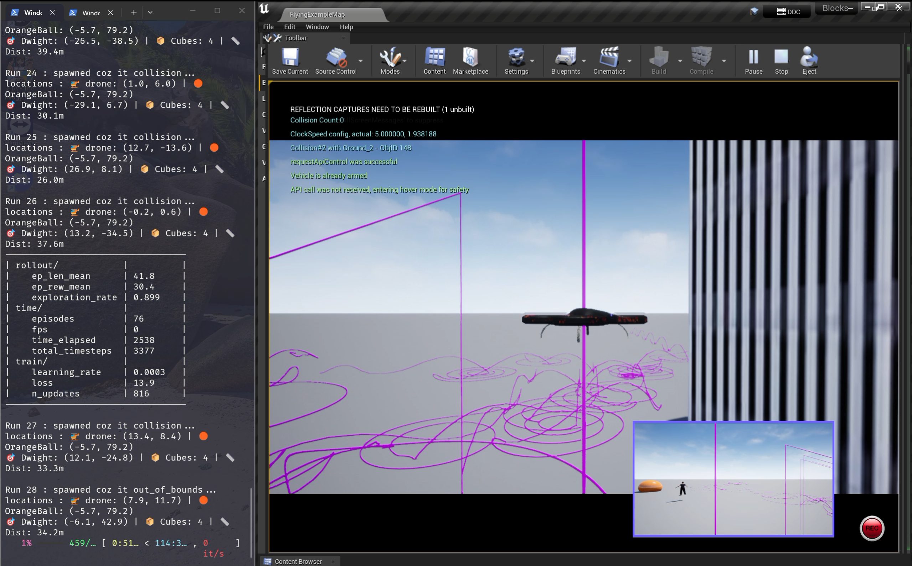
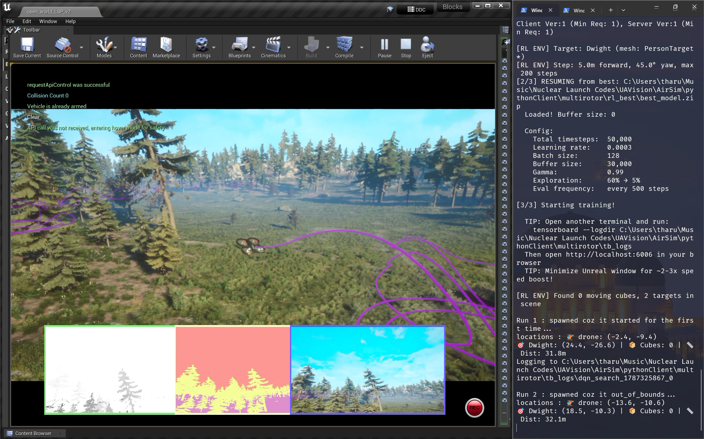
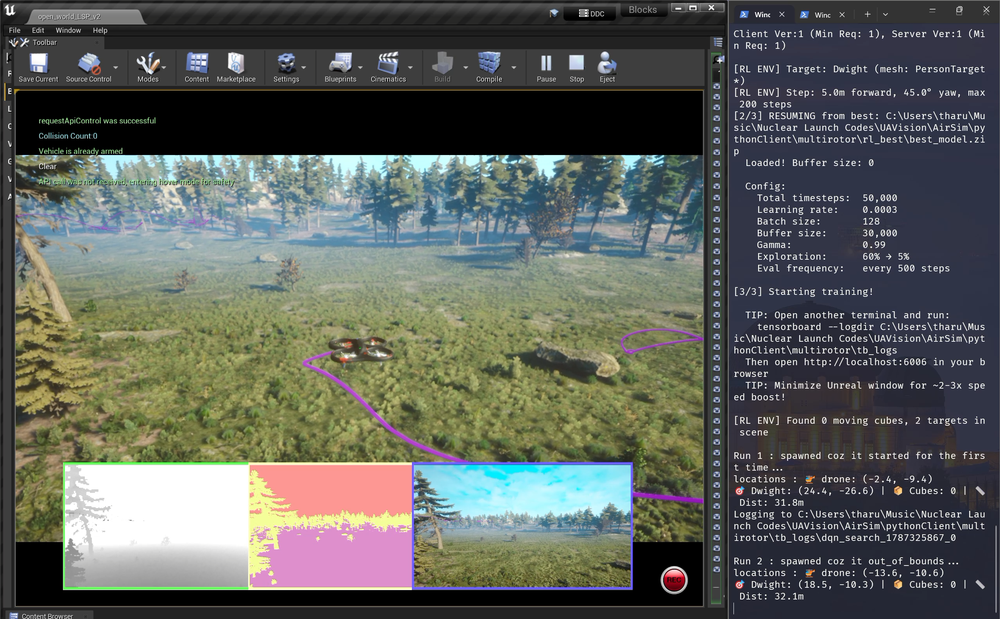

<div align="center">

# UAVision

### Autonomous Victim Detection and Terrain Exploration in Simulation

[](https://github.com/Tharun151425/UAVision-A-Simulation-Model-for-Real-Time-Victim-Detection-and-Terrain-Exploration/actions/workflows/ci.yml)
[](#quick-start)
[](https://pybullet.org/)
[](https://microsoft.github.io/AirSim/)
[](https://stable-baselines3.readthedocs.io/)
[](LICENSE)

**AirSim / Unreal Engine** for high-fidelity perception · **PyBullet** for scalable reinforcement learning · **DQN / PPO / RecurrentPPO** for search policies

[Overview](#overview) · [Architecture](#architecture) · [Results](#results) · [Quick start](#quick-start) · [Documentation](#documentation) · [Literature](#literature-survey)

</div>

---

<p align="center">
  
  <br>
  <em>Autonomous target-search policy operating in the AirSim forest environment, with live depth, segmentation, and flight telemetry.</em>
</p>

---

## Overview

UAVision is a simulation-first research platform for autonomous victim detection and terrain exploration. It combines a high-fidelity **AirSim / Unreal Engine** perception stack with a scalable **PyBullet** reinforcement-learning curriculum, giving search-and-rescue research a single, reproducible environment for perception, navigation, and policy evaluation.

The system addresses three coupled problems in aerial search:

1. **Perception** — detecting a person in a cluttered, photorealistic scene.
2. **Exploration** — covering unknown terrain without repeatedly searching the same area.
3. **Memory** — re-acquiring a target that becomes occluded behind terrain or structures.

AirSim provides RGB, depth, segmentation, LiDAR, and a camera-relative flight interface for high-fidelity validation. PyBullet provides fast, headless, procedurally generated maps for large-scale policy training. The two stacks share sensor and mapping abstractions while retaining independent observation contracts.

### At a glance

| | |
| --- | --- |
| **Simulators** | PyBullet (headless curriculum) · AirSim + Unreal Engine (perception and flight) |
| **Algorithms** | DQN · PPO · RecurrentPPO with LSTM memory |
| **Search phases** | 2A target recognition · 2B partial occlusion · 2C full-occlusion search |
| **Observations** | 262-value MLP · 519-value GRU · AirSim depth, LiDAR, and target vector |
| **Actions** | 6 discrete PyBullet actions · 5 discrete AirSim actions |
| **Perception** | Depth, LiDAR, RGB, and simulator segmentation |
| **Engineering controls** | Smoke tests · CI workflow · branch-separated history · model card · raw evaluation data |
| **License** | MIT |

---

## Architecture

<p align="center">
  
</p>

The platform is organised into five layers:

| Layer | Responsibility |
| --- | --- |
| **Simulation** | AirSim/Unreal for photorealistic sensing; PyBullet for scalable headless training |
| **Perception** | Depth images, LiDAR sectors, segmentation labels, and first-hit raycasts |
| **Memory** | Recurrent policy state and a 16×16 fog-of-war map of visited terrain |
| **Decision** | DQN for the AirSim baseline; PPO and RecurrentPPO for the PyBullet curriculum |
| **Evaluation** | Deterministic episodes, reward logging, checkpointing, and model cards |

### Runtime flow

```text
Reset environment
      │
      ▼
Fire sensors ──► build observation ──► policy selects action
      │                                      │
      │                                      ▼
      │                              apply action in simulator
      │                                      │
      │                                      ▼
      └────────────── update fog map ◄── reward + termination
                                             │
                                             ▼
                                   logs, checkpoints, evaluation
```

### Observation contracts

**PyBullet MLP — 262 values**

```text
256 ray codes (32 × 8) + 5 ego values + 1 time value = 262
```

**PyBullet GRU — 519 values**

```text
256 ray codes + 5 ego values + 256 fog cells + 1 time + 1 terrain = 519
```

Ray codes: `0` air · `1` ground · `2` obstacle · `3` survivor.

**AirSim — dictionary observation**

```python
{
    "image":      Box(0, 255, (84, 84, 1), uint8),   # depth
    "lidar":      Box(0, 100, (8,), float32),        # 8 sector minima
    "target_dir": Box(-1, 1, (3,), float32),         # relative direction
}
```

Full design notes: [`docs/ARCHITECTURE.md`](docs/ARCHITECTURE.md).

---

## Search curriculum

The PyBullet stack is organised as a three-phase curriculum. Each environment contains three internal difficulty levels with rolling-window promotion gates; the final level is the evaluation level.

| Phase | Research question | Target visibility | Memory requirement |
| --- | --- | --- | --- |
| **2A** | Can the agent recognise obstacles and a visible survivor? | Always visible | Optional |
| **2B** | Can it re-acquire a target that disappears mid-flight? | Visible, then occluded | Recurrent state |
| **2C** | Can it search a larger map when the target starts hidden? | May be fully hidden | Recurrent state + fog map |

### Perception and action design

- **First-hit raycasts** make occlusion observable: a survivor behind a wall returns obstacle code `2`, not survivor code `3`.
- **32 × 8 forward cone** with a 120° horizontal and 60° vertical field of view.
- **Six actions**: turn left, turn right, climb, descend, forward, scan.
- **No strafe or reverse**, because the sensor does not cover those directions.
- **Fog patch**: a 16 × 16 local map distinguishing visited from unknown cells.

---

## Operator tooling

- Manual camera-relative flight controller with a live perception HUD.
- Segmentation-based target overlay with confidence and distance readouts.
- Autonomous demo player with a LiDAR minimap and reward telemetry.
- Optional Unreal `CameraDirector` patch for camera control.
- Resumable DQN training with checkpoint and evaluation history.

---

## Results

### Environment validation

The shared sensor, fog-of-war map, and Phase-2 observation contracts are covered by a deterministic smoke suite:

```text
[PASS] shared raycast sensor + fog-of-war map
[PASS] Phase 2A environment reset/step (262-dim observation)
[PASS] Phase 2A GRU environment reset/step (519-dim observation)
All smoke checks passed.
```

The suite runs in CI on Python 3.11 and 3.12 for every push to `main`.

### Baseline policy evaluation

A baseline DQN checkpoint is included for reproducibility and comparison. Across five evaluation checkpoints and 15 recorded episodes:

| Metric | Value |
| --- | ---: |
| Mean episode reward | -214.79 |
| Best episode reward | -73.33 |
| Episode length | 200 steps |
| Evaluation horizon | 5 checkpoints × 3 episodes |

The baseline establishes the initial reference point for the AirSim search task. Full episode data and the model card are available in [`airsim/rl_best/`](airsim/rl_best/), with analysis in [`docs/RESULTS.md`](docs/RESULTS.md).

### Phase-2 validation

The Phase-2A, 2B, and 2C environments, including the recurrent GRU variants, pass reset and step contract tests. Training scripts support budgets from 800,000 to 4,000,000 steps, with configurable curriculum gates and deterministic evaluation episodes. The evaluation protocol is documented in [`phase_2/docs/PHASE_GUIDE.md`](phase_2/docs/PHASE_GUIDE.md).

---

## Screenshots

<p align="center">
  
  <br>
  <em>Autonomous search and target tracking in the AirSim forest environment.</em>
</p>

| | |
| --- | --- |
|  |  |
| **Training run with live telemetry and trajectory visualisation** | **Photorealistic forest environment with RGB, depth, and segmentation streams** |
|  | |
| **Autonomous flight and terrain exploration over large-scale terrain** | |

---

## Quick start

### PyBullet curriculum

```bash
git clone https://github.com/Tharun151425/UAVision-A-Simulation-Model-for-Real-Time-Victim-Detection-and-Terrain-Exploration.git
cd UAVision-A-Simulation-Model-for-Real-Time-Victim-Detection-and-Terrain-Exploration

python -m venv .venv
# Windows
.venv\Scripts\Activate.ps1
# Linux / macOS
source .venv/bin/activate

pip install -r requirements.txt
python scripts/smoke_test.py
```

Minimal dependencies for the smoke test only:

```bash
pip install numpy gymnasium pybullet
```

Train a phase:

```bash
python phase_2/phase_2A/training/train_phase2A.py
```

The script accepts an optional checkpoint path; pressing Enter starts a fresh run. Outputs are written to the ignored `checkpoints/` and `logs/` directories beside the training script.

### AirSim demonstration

An AirSim-enabled Unreal project, the AirSim Python client, and the project `settings.json` are required. Unreal project assets and simulator binaries are not distributed with this repository.

```bash
cd airsim
python -m venv .venv-air
.venv-air\Scripts\activate
pip install -r requirements.txt

# Install config/settings.json into Documents/AirSim/settings.json
# Open the AirSim scene, add a target actor named "Dwight", and start Play
python drone_full.py
python rl_play.py --model rl_best/best_model.zip --episodes 5
```

Installation, scene configuration, troubleshooting, and hardware notes: [`docs/SETUP.md`](docs/SETUP.md).

---

## Repository layout

```text
UAVision/
├── airsim/                  # AirSim client, DQN environment, training, demo, HUD, config
│   ├── config/settings.json
│   ├── docs/                # operator and RL guides
│   ├── patches/             # optional Unreal CameraDirector patch
│   └── rl_best/             # baseline checkpoint + model card
├── phase_2/                 # PyBullet curriculum
│   ├── phase_2A/            # target recognition
│   ├── phase_2B/            # partial occlusion
│   ├── phase_2C/            # full-occlusion search
│   └── docs/PHASE_GUIDE.md
├── sensors/                 # shared raycast sensor
├── utils/                   # shared fog-of-war map
├── scripts/                 # smoke test and utilities
├── docs/
│   ├── assets/              # architecture and timeline diagrams
│   └── media/               # demonstration video and environment captures
├── .github/                 # CI and contribution templates
├── CHANGELOG.md
├── CITATION.cff
└── README.md
```

### Research branches

| Branch | Scope |
| --- | --- |
| `main` | Integrated release: AirSim, PyBullet curriculum, documentation, CI |
| `legacy/old-unreal` | Original Unreal prototype: manual flight, segmentation detection, occupancy grid |
| `feature/airsim-rl` | AirSim DQN stage: environments, resumable training, evaluation, baseline model |
| `feature/sar-swarm` | PyBullet Phase-2 curriculum: MLP and GRU environments, shared sensors, fog map |

---

## Documentation

| Document | Contents |
| --- | --- |
| [`docs/ARCHITECTURE.md`](docs/ARCHITECTURE.md) | Layers, data flow, design decisions, extension points |
| [`docs/SETUP.md`](docs/SETUP.md) | PyBullet and AirSim installation, scene setup, troubleshooting |
| [`docs/RESULTS.md`](docs/RESULTS.md) | Verified evidence, baseline evaluation, limitations |
| [`docs/LITERATURE_SURVEY.md`](docs/LITERATURE_SURVEY.md) | 39-reference survey and project positioning |
| [`docs/ROADMAP.md`](docs/ROADMAP.md) | Validation, perception, multi-agent, and hardware milestones |
| [`phase_2/README.md`](phase_2/README.md) | Phase-2 environments, observations, training |
| [`phase_2/docs/PHASE_GUIDE.md`](phase_2/docs/PHASE_GUIDE.md) | Curriculum gates, evaluation protocol, debugging |
| [`airsim/README.md`](airsim/README.md) | AirSim observation, action, and reward contract |
| [`airsim/docs/GUIDE.md`](airsim/docs/GUIDE.md) | Operator setup, minimap, training workflow |
| [`airsim/rl_best/README.md`](airsim/rl_best/README.md) | Baseline model card and evaluation data |
| [`CHANGELOG.md`](CHANGELOG.md) | Release history and branch/tag map |
| [`CONTRIBUTING.md`](CONTRIBUTING.md) | Contribution workflow and experiment reporting |
| [`SECURITY.md`](SECURITY.md) | Vulnerability reporting and safe usage |

---

## Literature survey

UAVision sits at the intersection of search-and-rescue robotics, coverage planning, deep reinforcement learning, partial observability, and simulation. The full review is in [`docs/LITERATURE_SURVEY.md`](docs/LITERATURE_SURVEY.md).

| Area | Representative work | Design influence |
| --- | --- | --- |
| SAR robotics | Murphy et al. (2008); Goodrich et al. (2008); Waharte & Trigoni (2010) | Search as coverage and re-observation; human-in-the-loop relevance |
| Coverage and exploration | Galceran & Carreras (2013); Cabreira et al. (2019); Yamauchi (1997) | Frontier and coverage ideas behind the fog map and revisit terms |
| Detection | Redmon et al. (2016); Lin et al. (2017); Ronneberger et al. (2015) | Real-time detection and segmentation as the perception ceiling |
| Deep RL | Mnih et al. (2015); Schulman et al. (2017) | DQN for the AirSim baseline; PPO for the curriculum |
| Partial observability | Kaelbling et al. (1998); Hausknecht & Stone (2015) | RecurrentPPO with explicit spatial memory |
| Curriculum and rewards | Bengio et al. (2009); Narvekar et al. (2020); Ng et al. (1999) | Three-level gates and documented reward shaping |
| Simulation | Shah et al. (2018); Coumans & Bai (2016–2021) | AirSim for fidelity; PyBullet for scale |
| Sim-to-real | Tobin et al. (2017); Zhao et al. (2020) | Domain randomisation; transfer as future work |
| Multi-agent | Yu et al. (2022); Brambilla et al. (2013) | Shared-map and frontier concepts; swarm as roadmap |
| Evaluation | Henderson et al. (2018); Agarwal et al. (2021) | Fixed seeds, distributions, and baseline reporting |

The project does not introduce a new reinforcement-learning algorithm or detector. Its contribution is the integration of a multi-fidelity SAR testbed with explicit contracts, a reproducible curriculum, and a documented evaluation trail.

---

## Operational scope

UAVision is a research and engineering testbed for simulation-based search policies. The included DQN checkpoint is a baseline for comparison; Phase-2 environments are validated at the contract level and provide the foundation for further training and multi-seed evaluation.

The PyBullet environments use kinematic movement and abstract geometry rather than full flight dynamics. AirSim detection uses simulator segmentation rather than a learned detector. Unreal project assets and AirSim binaries are not distributed; an AirSim-enabled map must be supplied locally.

This software is intended for simulation and research. It is not a certified flight controller or rescue system and must not be used to control aircraft near people, property, or controlled airspace without the required training, permissions, and safety systems.

---

## Roadmap

| Release | Focus | Status |
| --- | --- | --- |
| **v1.0** | Integrated testbed, documentation, CI, baseline policy | **Released** |
| v1.1 | Multi-seed Phase-2 checkpoints and a shared evaluator | Planned |
| v1.2 | Stronger AirSim policy and reward ablations | Planned |
| v1.3 | Detector-in-the-loop perception baseline | Planned |
| v2.0 | Multi-agent frontier coordination and MAPPO | Roadmap |
| v2.1 | Hardware-in-the-loop with a safety supervisor | Roadmap |

Detailed definitions of done: [`docs/ROADMAP.md`](docs/ROADMAP.md).

---

## Contributing

Contributions are welcome in the following areas:

- reproducible training results with seeds and raw evaluation data;
- reward ablations that explain a failure mode;
- evaluation tooling for recurrent policies;
- documentation and CI improvements.

See [`CONTRIBUTING.md`](CONTRIBUTING.md) and [`CODE_OF_CONDUCT.md`](CODE_OF_CONDUCT.md). For security issues, follow [`SECURITY.md`](SECURITY.md).

---

## Citation

```bibtex
@software{tharun2026uavision,
  author  = {Tharun M},
  title   = {UAVision: A Simulation Model for Real-Time Victim Detection and Terrain Exploration},
  year    = {2026},
  version = {1.0.0},
  license = {MIT},
  url     = {https://github.com/Tharun151425/UAVision-A-Simulation-Model-for-Real-Time-Victim-Detection-and-Terrain-Exploration}
}
```

Metadata is available in [`CITATION.cff`](CITATION.cff).

---

## Acknowledgements

- Microsoft AirSim and the Unreal Engine community for the simulation stack.
- Bullet and PyBullet for fast physics simulation.
- Stable-Baselines3 and `sb3-contrib` for reliable reinforcement-learning implementations.
- The open-source Python scientific stack: NumPy, Gymnasium, PyTorch, TensorBoard, OpenCV, Pillow, and Matplotlib.

---

<div align="center">

**UAVision** · Simulation-first research for autonomous search and rescue · MIT License · 2026

</div>
