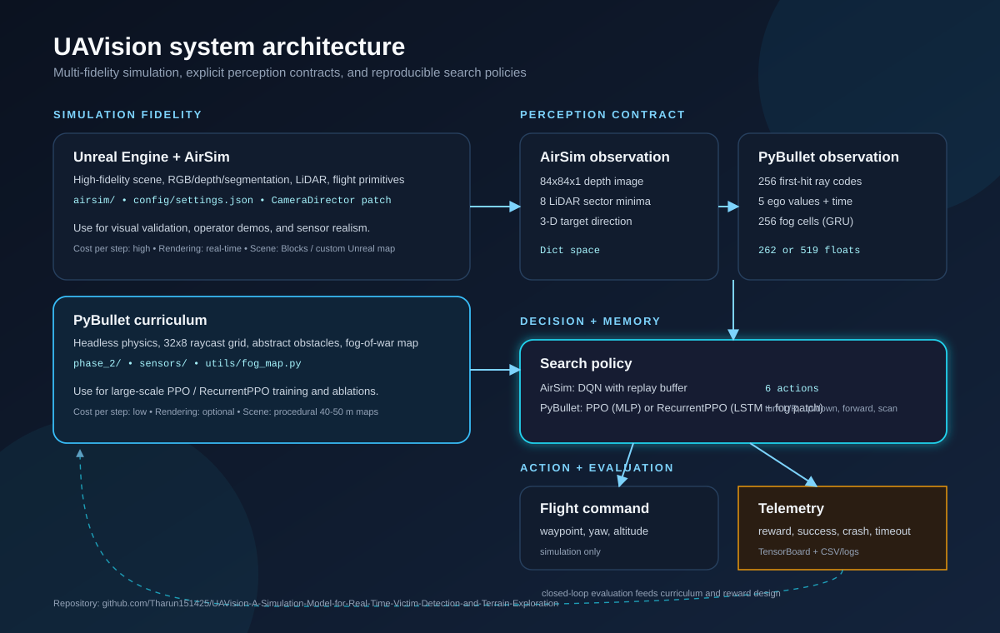
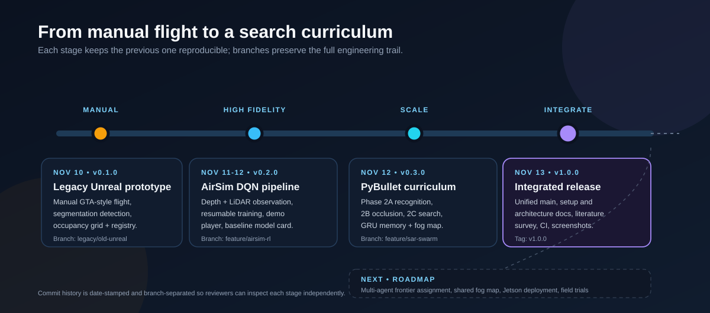
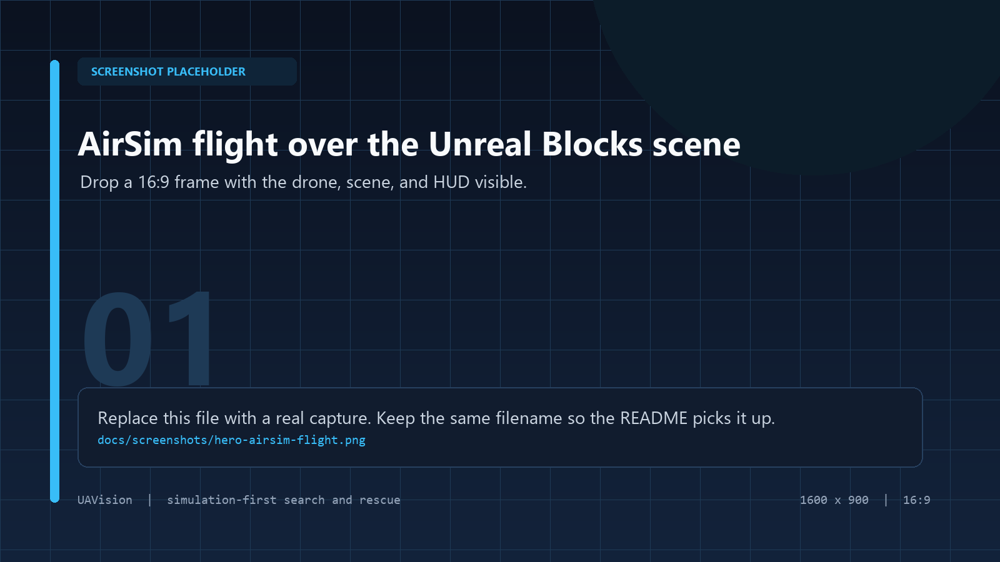
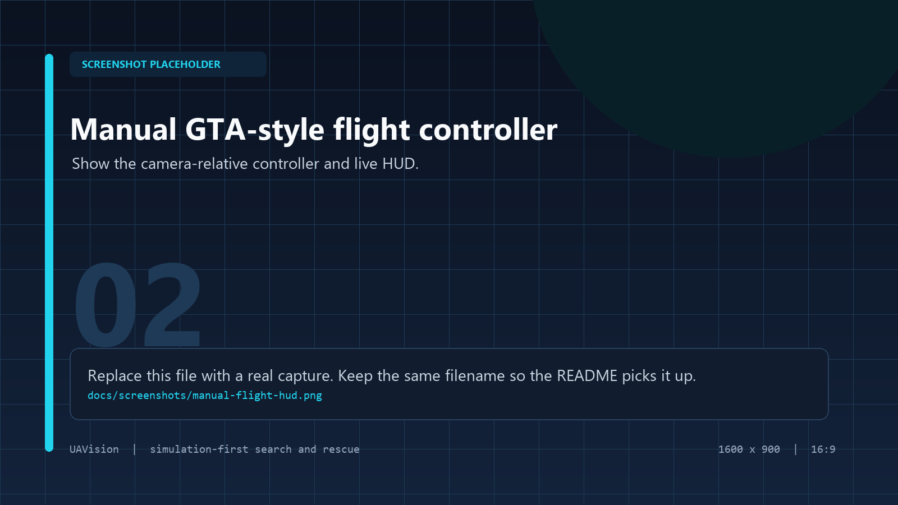
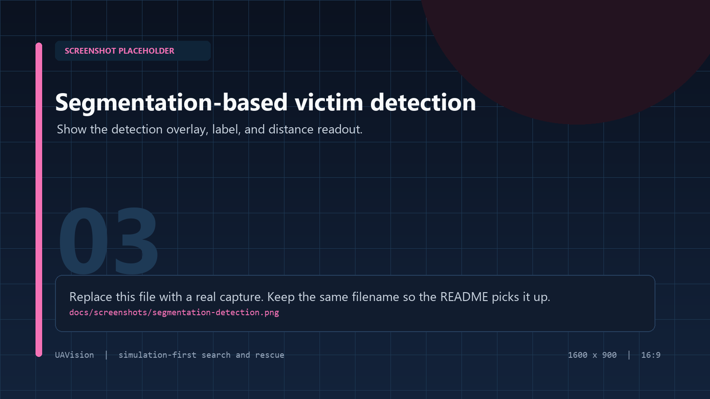
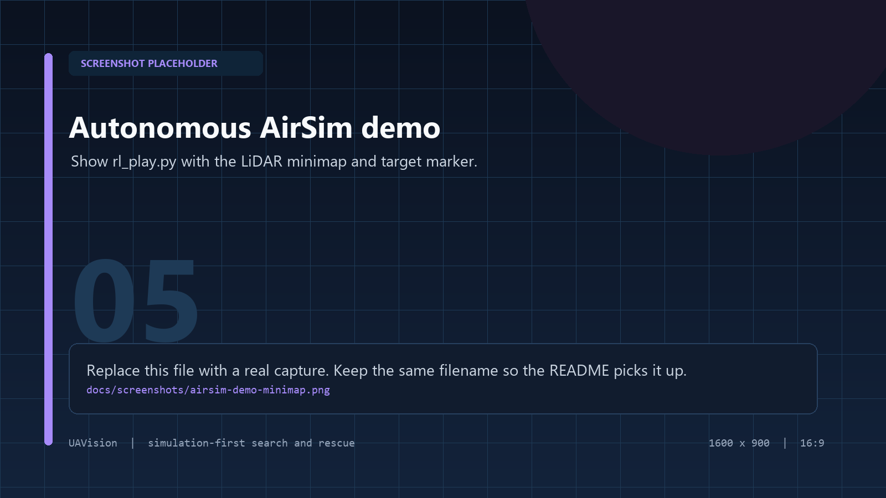
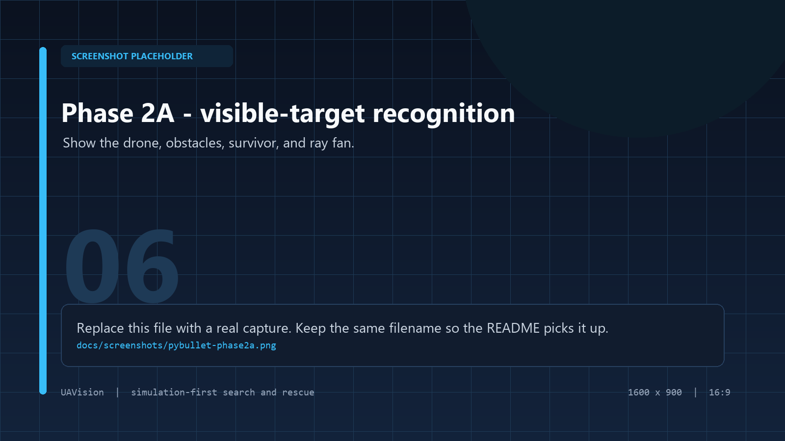
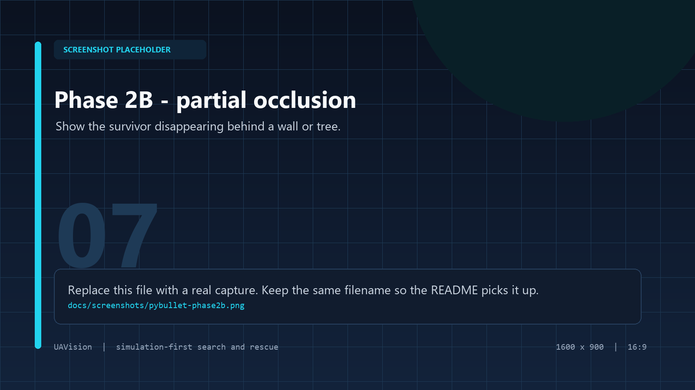
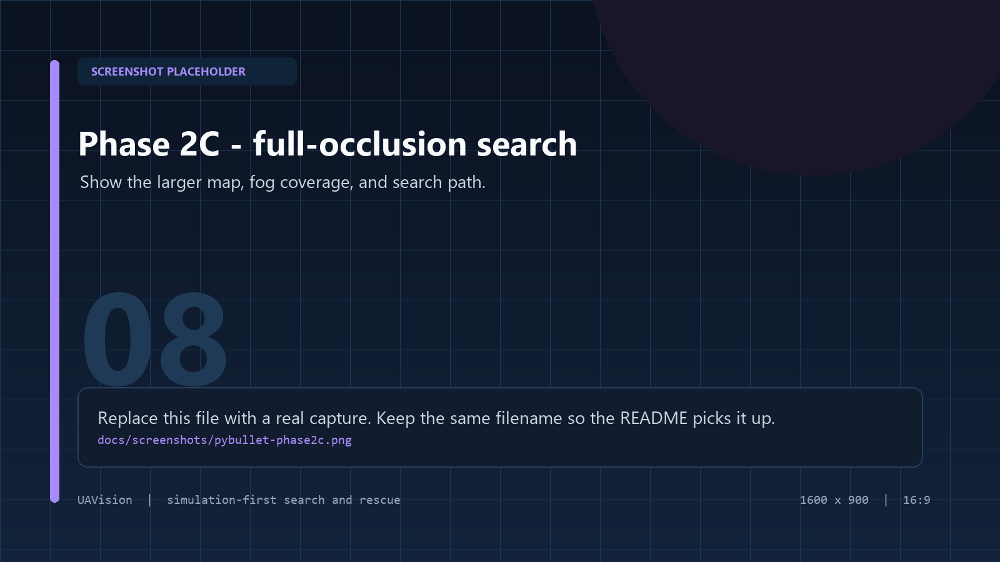
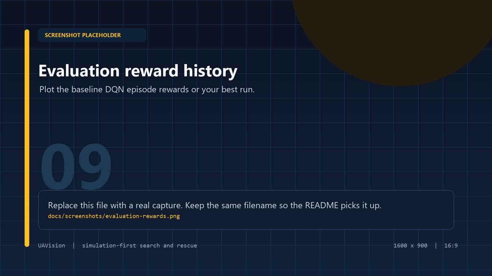

<div align="center">

# UAVision

### A simulation-first testbed for autonomous victim detection and terrain exploration

[](https://github.com/Tharun151425/UAVision-A-Simulation-Model-for-Real-Time-Victim-Detection-and-Terrain-Exploration/actions/workflows/ci.yml)
[](#quick-start)
[](https://pybullet.org/)
[](https://microsoft.github.io/AirSim/)
[](https://stable-baselines3.readthedocs.io/)
[](LICENSE)
[](#scope-and-limitations)

**AirSim / Unreal Engine** for high-fidelity perception · **PyBullet** for scalable RL · **PPO / RecurrentPPO / DQN** for search policies

[Overview](#overview) · [Architecture](#architecture) · [Quick start](#quick-start) · [Results](#results) · [Literature](#literature-survey) · [Docs](#documentation-map) · [Roadmap](docs/ROADMAP.md)

</div>

---

<p align="center">
  
</p>

---

## Overview

Search and rescue is a needle-in-a-haystack problem under partial observability.
A useful aerial search system has to answer three questions at once:

1. **What am I looking at?** — detect a person in a cluttered scene.
2. **Where should I go?** — explore unknown terrain without re-searching it.
3. **What did I already see?** — remember a target that disappeared behind a wall.

Most student UAV projects stop at a manual demo or a toy gridworld. UAVision
connects the two ends: a **high-fidelity AirSim/Unreal layer** for realistic
sensing and operator tooling, and a **lightweight PyBullet curriculum** for
large-scale reinforcement-learning experiments. The repository preserves the
legacy prototype, the AirSim DQN stage, and the Phase-2 search curriculum as
separate branches so the engineering trail is auditable.

**This is a research prototype, not a certified rescue system.** The included
DQN checkpoint is an early baseline, and no Phase-2 policy is claimed to be
converged. See [Scope and limitations](#scope-and-limitations).

---

## Why this project exists

| Common gap | UAVision response |
| --- | --- |
| Pretty simulator demo with no learning loop | AirSim Gymnasium environments, DQN training, evaluation, and demo player |
| Toy gridworld with no perception story | Depth, LiDAR, segmentation, and first-hit raycast contracts |
| Feed-forward agent that fails when the target is occluded | RecurrentPPO plus an explicit fog-of-war map |
| One-off notebooks with no reproducible history | Branch-separated, date-stamped commits, CI, model card, raw evaluation data |
| Results that overstate what the agent can do | Baseline evaluation reported honestly, including negative rewards |

### At a glance

| | |
| --- | --- |
| **Simulators** | PyBullet (headless curriculum) · AirSim + Unreal Engine (perception and flight) |
| **Algorithms** | DQN · PPO · RecurrentPPO (LSTM) |
| **Search phases** | 2A recognition · 2B partial occlusion · 2C full-occlusion search |
| **Observations** | 262-value MLP · 519-value GRU · AirSim depth + LiDAR + target vector |
| **Actions** | 6 discrete PyBullet actions · 5 discrete AirSim actions |
| **Included model** | One early DQN baseline, with raw evaluation history |
| **Engineering evidence** | Smoke test, CI workflow, branch-separated history, model card |
| **License** | MIT |

---

## Highlights

### 1. Multi-fidelity simulation, not one stack

- **AirSim / Unreal** provides RGB, depth, segmentation, LiDAR, and a
  camera-relative flight interface. It is the high-fidelity path for perception
  validation and operator demos.
- **PyBullet** provides fast, headless, procedural maps for PPO and
  RecurrentPPO. It is the scalable path for curriculum experiments.

The two paths intentionally use different observation contracts. A policy does
not magically transfer between them; the repository is explicit about that.

### 2. Three-phase search curriculum

| Phase | Question | Spawn visibility | Memory |
| --- | --- | --- | --- |
| **2A** | Can the agent recognise obstacles and a visible survivor? | Always visible | Optional |
| **2B** | Can it re-acquire a target that disappears mid-flight? | Visible, then occluded | Required for GRU |
| **2C** | Can it search a larger map when the target starts hidden? | May be fully hidden | GRU + fog map |

Each environment owns a three-level internal curriculum with rolling-window
promotion gates. The final level is the evaluation level. Pass criteria are
engineering targets, not published benchmark results.

### 3. Explicit perception and action contracts

- **First-hit raycasts** make occlusion observable: a survivor behind a wall
  returns obstacle code `2`, not survivor code `3`.
- **32x8 forward cone** with 120° horizontal and 60° vertical field of view.
- **Six actions**: turn left, turn right, climb, descend, forward, scan.
- **No strafe or reverse**, because the sensor does not cover those directions.
- **Fog patch**: a 16x16 local map of visited versus unknown cells.

### 4. Operator tooling, not just training scripts

- Manual GTA-style camera-relative flight controller.
- Live perception HUD with crosshair target identification.
- Segmentation-based detection overlay with distance readout.
- Autonomous demo player with a LiDAR minimap.
- Optional Unreal `CameraDirector` patch for camera control.

### 5. Reproducible engineering trail

- `main` is the integrated project.
- `legacy/old-unreal` preserves the original manual controllers and
  segmentation prototypes.
- `feature/airsim-rl` isolates the high-fidelity DQN stage.
- `feature/sar-swarm` isolates the PyBullet Phase-2 curriculum.
- Commit dates are spread across the development window, with Conventional
  Commit messages.
- CI runs a smoke test on every push.

---

## Architecture

<p align="center">
  
</p>

### Runtime flow

```text
Reset environment
      │
      ▼
Fire sensors ──► build observation ──► policy selects action
      │                                      │
      │                                      ▼
      │                              apply action in simulator
      │                                      │
      │                                      ▼
      └────────────── update fog map ◄── reward + termination
                                             │
                                             ▼
                                   logs, checkpoints, evaluation
```

### Observation contracts

**PyBullet MLP — 262 values**

```text
256 ray codes (32 x 8) + 5 ego values + 1 time value = 262
```

**PyBullet GRU — 519 values**

```text
256 ray codes + 5 ego values + 256 fog cells + 1 time + 1 terrain = 519
```

Ray codes: `0` air, `1` ground, `2` obstacle, `3` survivor.

**AirSim — dictionary observation**

```python
{
    "image":      Box(0, 255, (84, 84, 1), uint8),   # depth
    "lidar":      Box(0, 100, (8,), float32),        # 8 sector minima
    "target_dir": Box(-1, 1, (3,), float32),         # relative direction
}
```

Full details: [`docs/ARCHITECTURE.md`](docs/ARCHITECTURE.md).

---

## Development timeline

<p align="center">
  
</p>

| Stage | Branch | What changed |
| --- | --- | --- |
| Legacy Unreal prototype | `legacy/old-unreal` | Manual flight, segmentation detection, occupancy grid, object registry |
| AirSim DQN | `feature/airsim-rl` | Gymnasium env, depth + LiDAR, resumable DQN, demo player, baseline model |
| PyBullet curriculum | `feature/sar-swarm` | Phase 2A/2B/2C, MLP + GRU, raycast sensor, fog map, smoke test |
| Integrated release | `main` | Merged history, docs, CI, literature survey, screenshots |

---

## Results

### Verified: smoke test

```text
[PASS] shared raycast sensor + fog-of-war map
[PASS] Phase 2A environment reset/step (262-dim observation)
[PASS] Phase 2A GRU environment reset/step (519-dim observation)
All smoke checks passed.
```

### Baseline: AirSim DQN

The included checkpoint is an **early baseline**, not a strong policy. Across
five evaluation checkpoints and 15 recorded episodes:

| Metric | Value |
| --- | ---: |
| Mean episode reward | **-214.79** |
| Best episode reward | **-73.33** |
| Episode length | 200 steps (all episodes) |
| Outcome | Timeout on all recorded episodes |

This is useful evidence that the pipeline is wired correctly, and honest
evidence that the policy is not solved. Read the full breakdown in
[`docs/RESULTS.md`](docs/RESULTS.md) and the model card in
[`airsim/rl_best/README.md`](airsim/rl_best/README.md).

### Not claimed: Phase-2 performance

No Phase-2 checkpoint or multi-seed success table is included. Training budgets
range from 800,000 to 4,000,000 steps. The curriculum targets are documented,
but they are goals, not measured results. See
[`phase_2/docs/PHASE_GUIDE.md`](phase_2/docs/PHASE_GUIDE.md) for the evaluation
protocol.

---

## Screenshots

The images below are labelled placeholders. When real captures are added to
[`docs/screenshots/`](docs/screenshots/), keep the same filenames and the
README will pick them up automatically. Capture guidance is in
[`docs/screenshots/README.md`](docs/screenshots/README.md).

| | |
| --- | --- |
|  |  |
| **AirSim flight over the Blocks scene** | **Manual GTA-style flight + HUD** |
|  |  |
| **Segmentation-based victim detection** | **Autonomous demo + LiDAR minimap** |
|  |  |
| **Phase 2A: visible-target recognition** | **Phase 2B: partial occlusion** |
|  |  |
| **Phase 2C: full-occlusion search** | **Evaluation reward history** |

---

## Quick start

### PyBullet curriculum (recommended first run)

```bash
git clone https://github.com/Tharun151425/UAVision-A-Simulation-Model-for-Real-Time-Victim-Detection-and-Terrain-Exploration.git
cd UAVision-A-Simulation-Model-for-Real-Time-Victim-Detection-and-Terrain-Exploration

python -m venv .venv
# Windows
.venv\Scripts\Activate.ps1
# Linux / macOS
source .venv/bin/activate

pip install -r requirements.txt
python scripts/smoke_test.py
```

Minimal dependencies for the smoke test only:

```bash
pip install numpy gymnasium pybullet
```

Train a phase:

```bash
python phase_2/phase_2A/training/train_phase2A.py
```

The script prompts for a checkpoint path. Press Enter to start fresh. Outputs
go to ignored `checkpoints/` and `logs/` directories beside the training
script.

### AirSim demo

You need an AirSim-enabled Unreal project, the AirSim Python client, and the
project `settings.json`. The Unreal project and assets are **not** included.

```bash
cd airsim
python -m venv .venv-air
.venv-air\Scripts\activate
pip install -r requirements.txt

# Copy config/settings.json to Documents/AirSim/settings.json
# Open the AirSim Blocks scene, add a target actor named "Dwight", press Play
python drone_full.py
python rl_play.py --model rl_best/best_model.zip --episodes 5
```

Full instructions, troubleshooting, and hardware notes:
[`docs/SETUP.md`](docs/SETUP.md).

---

## Repository layout

```text
UAVision/
├── airsim/                  # AirSim client, DQN env, training, demo, HUD, config
│   ├── config/settings.json
│   ├── docs/                # operator and RL guides
│   ├── patches/             # optional Unreal CameraDirector patch
│   └── rl_best/             # baseline checkpoint + model card
├── phase_2/                 # PyBullet curriculum
│   ├── phase_2A/            # recognition, no occlusion
│   ├── phase_2B/            # partial occlusion
│   ├── phase_2C/            # full occlusion, search
│   └── docs/PHASE_GUIDE.md
├── sensors/                 # shared raycast sensor
├── utils/                   # shared fog-of-war map
├── scripts/                 # smoke test and utilities
├── docs/                    # architecture, setup, results, survey, assets
│   ├── assets/              # SVG diagrams
│   ├── screenshots/         # screenshot drop zone
│   └── media/               # video guidance
├── .github/                 # CI and contribution templates
├── CHANGELOG.md
├── CITATION.cff
└── README.md
```

### What is not in the repository

- Unreal `.uproject`, `.uasset`, `.umap`, `Content/`, `Plugins/`, `Binaries/`,
  `Intermediate/`, or build output.
- The full AirSim source clone, AirLib, MavLinkCom, or simulator binaries.
- Virtual environments, TensorBoard event files, training checkpoints, and
  multi-gigabyte logs.
- Raw video captures; see [`docs/media/README.md`](docs/media/README.md).

The repository is designed to be usable from the code layer. You provide the
simulator; the project provides the environments, training code, configuration,
and documentation.

---

## Documentation map

| Document | What it covers |
| --- | --- |
| [`docs/ARCHITECTURE.md`](docs/ARCHITECTURE.md) | Layers, data flow, design decisions, extension points |
| [`docs/SETUP.md`](docs/SETUP.md) | PyBullet and AirSim installation, scene setup, troubleshooting |
| [`docs/RESULTS.md`](docs/RESULTS.md) | Verified evidence, baseline numbers, limitations |
| [`docs/LITERATURE_SURVEY.md`](docs/LITERATURE_SURVEY.md) | 39-reference survey and project positioning |
| [`docs/ROADMAP.md`](docs/ROADMAP.md) | Validation, perception, swarm, and hardware milestones |
| [`phase_2/README.md`](phase_2/README.md) | Phase-2 environments, observations, training |
| [`phase_2/docs/PHASE_GUIDE.md`](phase_2/docs/PHASE_GUIDE.md) | Curriculum gates, evaluation protocol, debugging |
| [`airsim/README.md`](airsim/README.md) | AirSim observation/action/reward contract and demo |
| [`airsim/docs/GUIDE.md`](airsim/docs/GUIDE.md) | Operator setup, minimap, training workflow |
| [`airsim/rl_best/README.md`](airsim/rl_best/README.md) | Baseline model card |
| [`CHANGELOG.md`](CHANGELOG.md) | Release history and branch/tag map |
| [`CONTRIBUTING.md`](CONTRIBUTING.md) | Contribution workflow and experiment reporting |
| [`SECURITY.md`](SECURITY.md) | Vulnerability reporting and safe usage |

---

## Literature survey

UAVision sits at the intersection of search-and-rescue robotics, coverage
planning, deep reinforcement learning, partial observability, and simulation.
The full review is in
[`docs/LITERATURE_SURVEY.md`](docs/LITERATURE_SURVEY.md); this is the short
version.

| Area | Representative work | What UAVision takes from it |
| --- | --- | --- |
| SAR robotics | Murphy et al. (2008); Goodrich et al. (2008); Waharte & Trigoni (2010) | Search is coverage **and** re-observation; the human loop matters |
| Coverage and exploration | Galceran & Carreras (2013); Cabreira et al. (2019); Yamauchi (1997) | Frontier/coverage ideas motivate the fog map and revisit terms |
| Detection | Redmon et al. (2016); Lin et al. (2017); Ronneberger et al. (2015) | Real-time detection and segmentation are the perception ceiling |
| Deep RL | Mnih et al. (2015); Schulman et al. (2017) | DQN for the AirSim baseline; PPO for the curriculum |
| Partial observability | Kaelbling et al. (1998); Hausknecht & Stone (2015) | RecurrentPPO plus explicit spatial memory |
| Curriculum and rewards | Bengio et al. (2009); Narvekar et al. (2020); Ng et al. (1999) | Three-level gates and explicit reward documentation |
| Simulation | Shah et al. (2018); Coumans & Bai (2016-2021) | AirSim for fidelity; PyBullet for scale |
| Sim-to-real | Tobin et al. (2017); Zhao et al. (2020) | Domain randomisation; no transfer claim |
| Multi-agent | Yu et al. (2022); Brambilla et al. (2013) | Shared-map and frontier concepts; swarm is roadmap |
| Evaluation | Henderson et al. (2018); Agarwal et al. (2021) | Fixed seeds, distributions, honest baselines |

> The project does not introduce a new RL algorithm or detector. Its
> contribution is the integration of a multi-fidelity SAR testbed with explicit
> contracts, a reproducible curriculum, and an honest evaluation trail.

---

## Scope and limitations

**What this project is**

- A research and engineering testbed for simulation-based SAR search policies.
- A reproducible curriculum for recognition, re-acquisition, and exploration.
- A demonstration of multi-fidelity simulation and explicit RL contracts.
- A portfolio-quality codebase with a documented failure history.

**What it is not**

- A certified flight controller or rescue product.
- A real-time detector validated on real casualty imagery.
- A sim-to-real success story.
- A completed multi-agent swarm.
- A benchmark leaderboard entry.

**Known limitations**

- The included DQN baseline has negative evaluation rewards and times out.
- No Phase-2 checkpoint or multi-seed benchmark is included.
- PyBullet uses kinematic movement and abstract geometry, not full flight
  dynamics.
- AirSim detection uses simulator segmentation, not a learned detector.
- Curriculum gates use a fixed 100-episode window and can be noisy.
- The Unreal project is not distributed; you must provide an AirSim-enabled map.

**Safety:** do not use this code to control a real aircraft near people,
property, or airspace without the required training, permissions, and safety
systems.

---

## Roadmap

| Release | Focus | Status |
| --- | --- | --- |
| **v1.0** | Integrated testbed, docs, CI, baseline | **Complete** |
| v1.1 | Validate Phase 2 with multi-seed checkpoints and a shared evaluator | Planned |
| v1.2 | Stronger AirSim policy and reward ablations | Planned |
| v1.3 | Detector-in-the-loop perception baseline | Planned |
| v2.0 | Multi-agent frontier coordination and MAPPO | Roadmap |
| v2.1 | Hardware-in-the-loop with safety supervisor | Roadmap |

Details and definitions of done: [`docs/ROADMAP.md`](docs/ROADMAP.md).

---

## Contributing

Contributions are welcome, especially:

- reproducible training results with seeds and raw evaluation data;
- reward ablations that explain a failure mode;
- evaluation tooling for recurrent policies;
- documentation fixes and screenshot contributions;
- CI or packaging improvements.

Read [`CONTRIBUTING.md`](CONTRIBUTING.md) and
[`CODE_OF_CONDUCT.md`](CODE_OF_CONDUCT.md) first. For security issues, follow
[`SECURITY.md`](SECURITY.md).

---

## Citation

If you use this project in academic work, cite it using
[`CITATION.cff`](CITATION.cff):

```bibtex
@software{tharun2026uavision,
  author  = {Tharun M},
  title   = {UAVision: A Simulation Model for Real-Time Victim Detection and Terrain Exploration},
  year    = {2026},
  version = {1.0.0},
  license = {MIT},
  url     = {https://github.com/Tharun151425/UAVision-A-Simulation-Model-for-Real-Time-Victim-Detection-and-Terrain-Exploration}
}
```

---

## Acknowledgements

- Microsoft AirSim and the Unreal Engine community for the simulation stack.
- Bullet/PyBullet for fast physics simulation.
- Stable-Baselines3 and `sb3-contrib` for reliable RL implementations.
- The open-source Python scientific stack: NumPy, Gymnasium, PyTorch,
  TensorBoard, OpenCV, Pillow, and Matplotlib.

---

<div align="center">

**Built as a research-engineering project — measured, documented, and honest about what does not work yet.**

MIT License · 2026 · Tharun M

</div>
