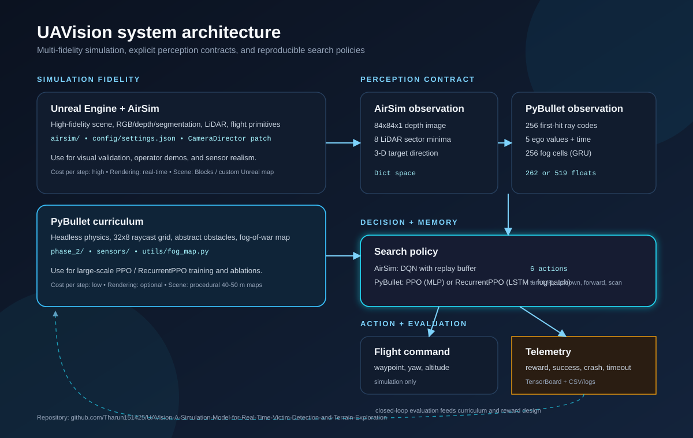
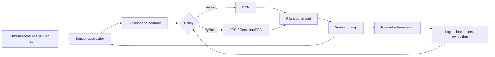

# Architecture

UAVision is a simulation-first search-and-rescue research platform. It is built
around one idea: a search policy is only meaningful when its observation
contract, action contract, and evaluation protocol are explicit. The repository
therefore ships two simulation fidelities that share that discipline rather than
one monolithic demo.



---

## 1. Design goals

| Goal | How the repository addresses it |
| --- | --- |
| Fast iteration | PyBullet headless curriculum with small observations and discrete actions |
| Perceptual realism | AirSim RGB/depth/segmentation/LiDAR stack inside Unreal Engine |
| Partial observability | Recurrent PPO, explicit fog-of-war map, first-hit raycast semantics |
| Reproducibility | Fixed seeds, deterministic evaluation, checkpointing, human-readable logs |
| Inspectability | Separate branches for each stage and small, reviewable commits |
| Honest reporting | Baseline model card, recorded negative evaluation, no invented metrics |
| Path to swarms | Shared map and frontier concepts, with multi-agent work marked as roadmap |

### Non-goals

- A certified flight controller.
- A real-time detector trained on real casualty imagery.
- A full digital twin of a specific Unreal level.
- A drop-in sim-to-real pipeline.

---

## 2. Runtime layers

### 2.1 Simulation layer

| Backend | Entry point | Step cost | Observation source |
| --- | --- | --- | --- |
| Unreal + AirSim | `airsim/` | High | RGB, depth, segmentation, LiDAR, distance sensor |
| PyBullet | `phase_2/` | Low | 32x8 raycast grid, pose, fog patch |

Both backends expose a Gymnasium-style `reset()` / `step()` interface. They do
not share a policy or a checkpoint format because their observation spaces are
different by design. Sharing a policy would require an adapter and a
retraining budget; the repository does not pretend otherwise.

### 2.2 Perception layer

**AirSim path**

- `rl_drone_env.py` builds a dictionary observation:
  - `image`: 84x84x1 depth image, uint8;
  - `lidar`: eight sector minima, float32;
  - `target_dir`: three-component relative direction, float32.
- Segmentation is used for target identity and localisation. This is simulator
  ground truth, not a learned detector.
- `drone_vision.py` provides a crosshair readout for manual inspection.
- `CameraDirector.cpp` / `.h` are optional Unreal-side patches for camera
  control. They are documented in `airsim/patches/README.md`.

**PyBullet path**

- `sensors/raycast.py` and `sensors/raycast_gru.py` fire a forward cone of
  32x8 rays and return first-hit integer codes.
- Ray codes: `0` air, `1` ground, `2` obstacle, `3` survivor.
- `utils/fog_map.py` maintains a 2D visited/unknown grid and extracts a 16x16
  local patch.
- The GRU observation is `256 rays + 5 ego + 256 fog + 1 time + 1 terrain = 519`.
- The MLP observation drops the fog patch: `256 + 5 + 1 = 262`.

The first-hit rule is the key perceptual invariant. Occlusion is represented by
what the ray actually hits, so a policy cannot see through walls.

### 2.3 Decision layer

| Path | Algorithm | Memory | Action space |
| --- | --- | --- | --- |
| AirSim single target | DQN (`MultiInputPolicy`) | Replay buffer, no recurrent state | 5 discrete |
| AirSim multi-target | DQN | Replay buffer | 5 discrete |
| PyBullet 2A/2B MLP | PPO (`MlpPolicy`) | None | 6 discrete |
| PyBullet GRU | RecurrentPPO (`MlpLstmPolicy`) | 128-unit LSTM + fog patch | 6 discrete |

The AirSim action set is forward, up, down, yaw left, yaw right. The PyBullet
action set adds `SCAN`, which holds position while the sensor fires. Neither set
includes strafing or reverse, because the forward sensor cone does not cover
those directions.

### 2.4 Memory and map layer

The PyBullet GRU environments combine two kinds of memory:

1. **Recurrent state** inside the LSTM, which carries recent observations and
   actions across steps.
2. **Explicit spatial memory** in the fog map, which records which cells have
   been visited.

The explicit map is what makes coverage measurable. It also gives the policy a
stable signal for "where have I already been?" even when the LSTM state is
imperfect. The map is shared by reference inside a single process; distributed
sharing is a roadmap item, not an implemented feature.

### 2.5 Evaluation layer

- Stable-Baselines3 `EvalCallback` writes `evaluations.npz` for the AirSim DQN
  baseline.
- Training scripts write TensorBoard events and a human-readable episode log.
- The smoke test validates observation shapes and one reset/step cycle.
- Evaluation guidance is in [`phase_2/docs/PHASE_GUIDE.md`](../phase_2/docs/PHASE_GUIDE.md).

The repository does not ship a benchmark harness that claims statistical
significance. Results are reported as engineering evidence with the protocol
that produced them.

---

## 3. End-to-end mission flow



A single episode has five phases:

1. **Reset:** randomise drone pose, target pose, obstacles, and yaw; seed NumPy.
2. **Observe:** fire rays or capture sensors; assemble the observation.
3. **Act:** policy selects a discrete action; simulator applies it.
4. **Evaluate:** compute reward, check collision/altitude/timeout, update fog.
5. **Terminate:** survivor reached, crash, or time limit; log the outcome.

---

## 4. Repository layout

```text
UAVision/
├── airsim/                 # AirSim client, DQN env/training/demo, HUD, config
│   ├── config/             # AirSim settings.json
│   ├── docs/               # operator and RL guides
│   ├── patches/            # optional Unreal camera patches
│   └── rl_best/            # baseline checkpoint + model card
├── phase_2/                # PyBullet curriculum
│   ├── phase_2A/           # visible-target recognition
│   ├── phase_2B/           # partial occlusion / re-acquisition
│   ├── phase_2C/           # full occlusion / search
│   └── docs/               # curriculum design and evaluation guide
├── sensors/                # shared raycast sensor (GRU path)
├── utils/                  # shared fog-of-war map
├── scripts/                # smoke test and utilities
├── docs/                   # architecture, setup, results, survey, assets
└── .github/                # CI and contribution templates
```

### What is intentionally excluded

- Unreal `.uproject`, `.uasset`, `.umap`, `Content/`, `Plugins/`, `Binaries/`,
  `Intermediate/`, and build output.
- The full AirSim source clone, AirLib, MavLinkCom, and simulator binaries.
- Virtual environments, TensorBoard event files, training checkpoints, and
  multi-gigabyte logs.
- Raw video captures. See [`docs/media/README.md`](media/README.md).

The repository is meant to be usable from the code layer. You provide the
simulator; the project provides the environments, training code, configuration,
and documentation.

---

## 5. Branch architecture

| Branch | Contents | Why it exists |
| --- | --- | --- |
| `main` | Integrated v1.0 project | Default clone target; docs, CI, full code |
| `legacy/old-unreal` | Manual controllers, segmentation prototypes, occupancy grid | Preserves the original Unreal-era engineering trail |
| `feature/airsim-rl` | AirSim Gymnasium env, DQN training/demo, baseline checkpoint | Isolates the high-fidelity RL experiment |
| `feature/sar-swarm` | PyBullet Phase 2A/2B/2C, shared sensors/fog, smoke test | Isolates the scalable curriculum |

The branches are intentionally not squashed into one commit. A reviewer can
inspect the evolution of the observation contract, the reward fixes, and the
training pipeline separately. `main` contains merge commits that record when
each stage was integrated.

---

## 6. Key design decisions

### Why first-hit raycasts instead of a depth image in PyBullet?

Depth images are rich but expensive to render and hard to debug in a headless
curriculum. Integer first-hit codes give a compact, interpretable observation:
air, ground, obstacle, survivor. They also make occlusion explicit. The AirSim
path uses depth and LiDAR for higher fidelity.

### Why a 32x8 grid?

It is large enough to represent a 120x60-degree forward cone with useful
angular resolution, and small enough to flatten into 256 values. The resulting
observation is compatible with small MLPs and LSTMs that train on CPU.

### Why include both MLP and GRU variants?

The MLP variant is a control condition: it tests what can be learned without
memory. The GRU variant adds recurrence and the fog patch. Comparing them
isolates the contribution of memory and spatial context. The repository does
not claim a completed ablation; it provides the code to run one.

### Why three phases?

Recognition, re-acquisition, and exploration are different failure modes. A
policy that can track a visible target may still fail when the target is
occluded, and a policy that handles occlusion may still lack a systematic search
strategy. The phases isolate those capabilities and provide separate pass
criteria.

### Why fixed discrete actions?

Fixed steps make early training stable and keep the action space auditable.
Continuous control is a later-fidelity concern and belongs in the AirSim or
hardware stack.

### Why not publish the Unreal project?

The Unreal project is large, environment-specific, and contains proprietary or
licensed assets. Publishing it would make the repository enormous and still not
guarantee a runnable scene. The code, config, and camera patch are the reusable
artifacts. The setup guide explains how to attach them to an AirSim-enabled map.

---

## 7. Failure modes and mitigations

| Failure mode | Mitigation in the repository |
| --- | --- |
| Reward hacking (spinning, hovering) | Explicit anti-spin, time, proximity, and coverage terms; reward docstrings record past exploits |
| Observation mismatch after transfer | Shape assertions in the smoke test; separate 262/519 contracts |
| Silent curriculum promotion | Promotion logs and per-episode outcome logs |
| Scene-specific overfitting | Domain randomisation of pose, target, obstacles, and yaw |
| Unreal dependency hell | Separate AirSim environment; documented pinned client stack |
| Large binary leaks | `.gitignore` rules for models, builds, assets, logs, and video |
| Broken imports | Flat `airsim/` layout; package layout under `phase_2/`; shared root modules |
| Unverifiable claims | Model card, raw `evaluations.npz`, and explicit limitations |

---

## 8. Extension points

- **New phase:** add a folder with `envs/`, `rewards/`, `training/`, and a
  `CURRICULUM_LEVELS` dictionary; update the smoke test.
- **New sensor:** implement a `fire()` method returning the ray grid, then
  extend `_get_obs` and `observation_space`.
- **New policy:** keep the Gymnasium contract and add an entry point under the
  relevant `training/` folder.
- **Swarm:** extend the fog map with frontier assignment and a shared update
  protocol; the current code is single-agent only.
- **Real hardware:** replace the simulator adapter, keep the observation/action
  contracts, and add a safety supervisor. This is not implemented.

---

## 9. Related documents

- [Setup](SETUP.md)
- [Results](RESULTS.md)
- [Literature survey](LITERATURE_SURVEY.md)
- [Roadmap](ROADMAP.md)
- [Phase 2 guide](../phase_2/docs/PHASE_GUIDE.md)
- [AirSim module](../airsim/README.md)
