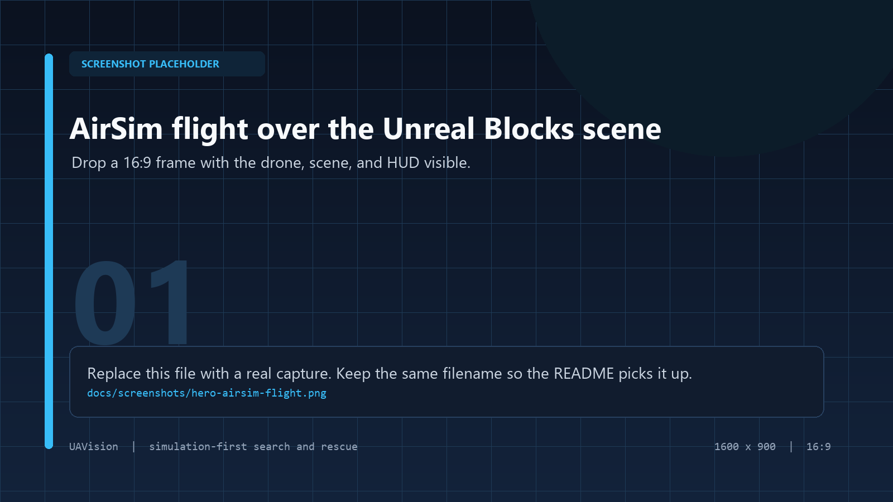
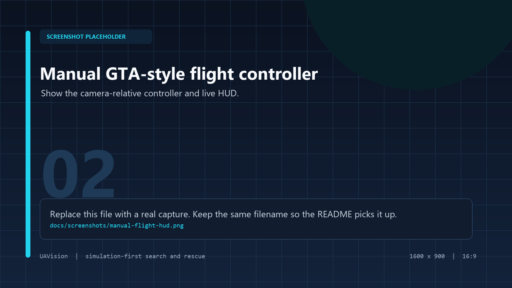
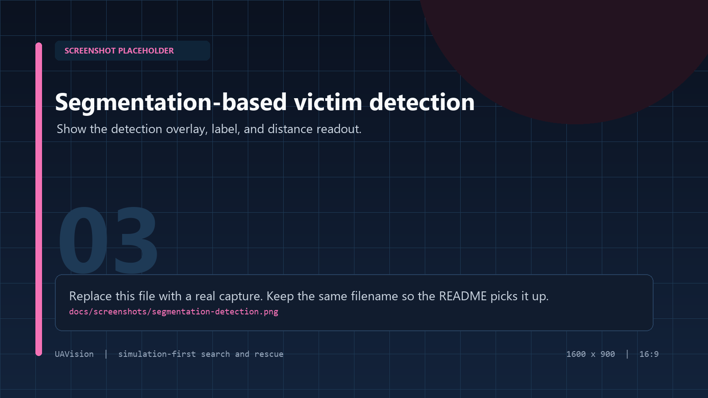
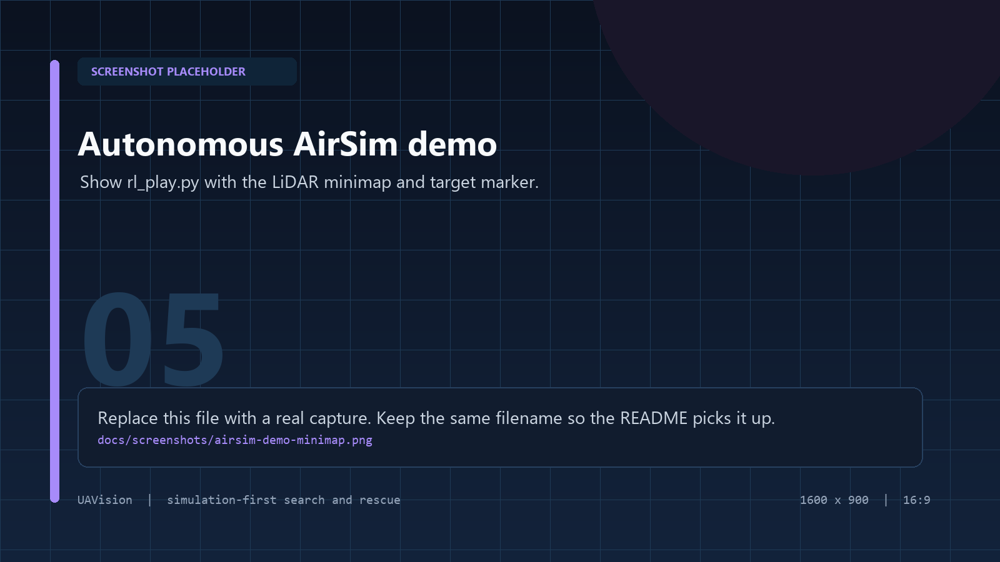
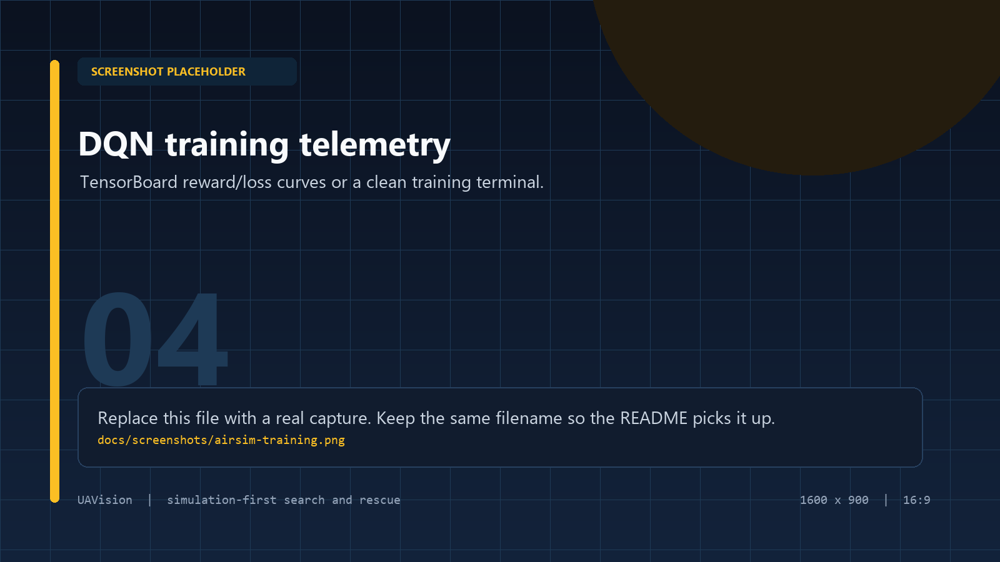
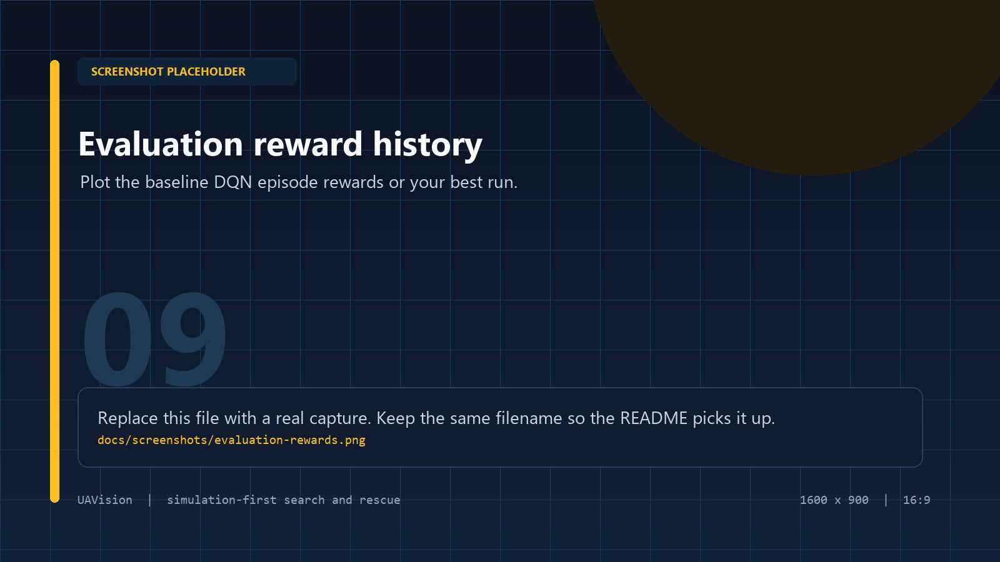
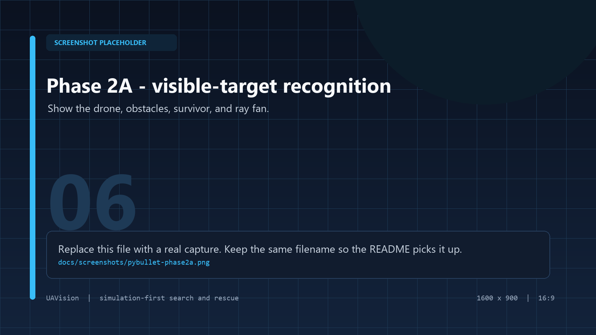
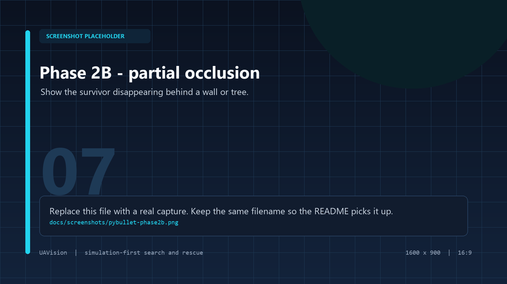
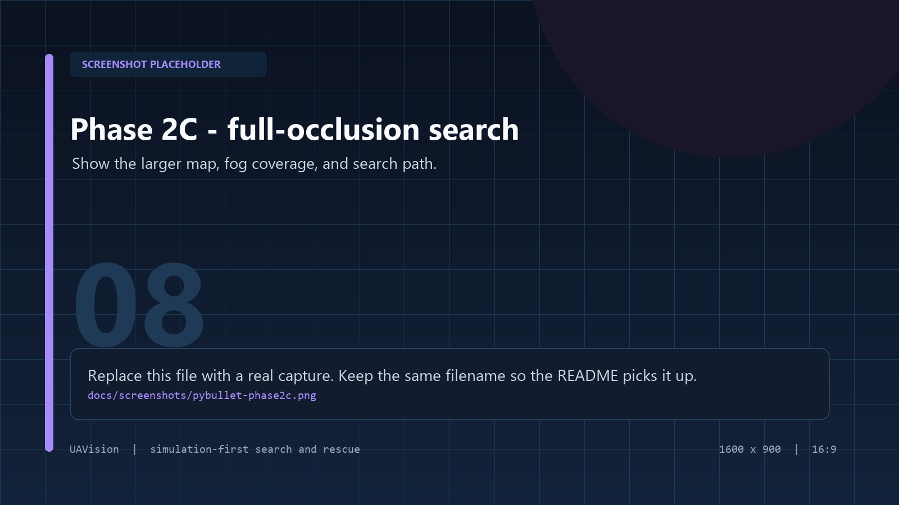

# Results and Evidence

This page separates **verified engineering evidence** from **baseline results**
and **unverified training targets**. The distinction is intentional. A working
pipeline is not the same as a strong policy.

---

## 1. Evidence tiers

| Tier | What it means | Where it appears |
| --- | --- | --- |
| Verified in CI | Runs on every push with the minimal PyBullet stack | `scripts/smoke_test.py` |
| Verified locally | Recorded output or raw evaluation file | Smoke test output, `evaluations.npz` |
| Baseline only | Pipeline works but policy quality is poor | AirSim DQN checkpoint |
| Not included | Requires a full training run to produce | Phase 2 success rates |
| Roadmap | Not implemented | Multi-agent swarm, hardware deployment |

---

## 2. Verified: environment smoke test

Command:

```bash
python scripts/smoke_test.py
```

Recorded output on Python 3.12 with PyBullet:

```text
UAVision smoke test
==================================================
[PASS] shared raycast sensor + fog-of-war map
[PASS] Phase 2A environment reset/step (262-dim observation)
[PASS] Phase 2A GRU environment reset/step (519-dim observation)
==================================================
All smoke checks passed.
```

What it verifies:

- shared raycast sensor dimensions and range;
- fog-of-war visit semantics and 256-element patch shape;
- Phase 2A environment reset/step contract;
- 262-value MLP observation shape;
- 519-value GRU observation shape;
- discrete six-action space.

What it does **not** verify:

- learning performance;
- long-horizon stability;
- AirSim RPC and Unreal rendering;
- GPU or multi-process behaviour.

The CI workflow installs only `numpy`, `gymnasium`, and `pybullet` for the
smoke job. That keeps CI fast and avoids pulling PyTorch for a shape test.

---

## 3. Baseline: AirSim DQN checkpoint

The repository includes one curated checkpoint at
`airsim/rl_best/best_model.zip`. It is a DQN `MultiInputPolicy` trained in the
AirSim Blocks scene on a single target. The raw evaluation history is in
`airsim/rl_best/evaluations.npz`.

### Evaluation history

The file contains five evaluation checkpoints, each with three episodes. Every
recorded episode reached the 200-step limit.

| Timestep | Episode 1 | Episode 2 | Episode 3 | Mean |
| ---: | ---: | ---: | ---: | ---: |
| 4,500 | -73.33 | -78.37 | -74.90 | -75.53 |
| 5,000 | -201.79 | -212.80 | -1,072.31 | -495.63 |
| 5,500 | -185.13 | -214.97 | -79.69 | -159.93 |
| 6,000 | -234.85 | -278.29 | -276.66 | -263.27 |
| 6,500 | -75.36 | -82.72 | -80.70 | -79.59 |

Overall mean reward: **-214.79**. Best single episode: **-73.33**. Episode
length: **200 steps** for all 15 episodes.

### Interpretation

- The pipeline is wired correctly: the environment resets, observations are
  produced, actions are applied, rewards are computed, and evaluation results
  are written in the standard Stable-Baselines3 format.
- The policy is **not** a strong search agent. The negative mean reward and
  100% timeout rate mean it did not reliably reach the target within the episode
  budget. The -1,072 outlier is consistent with a collision-heavy or
  inefficient episode, not with a hidden success.
- The checkpoint is useful for a demo of the mechanics and for testing the
  loading/inference path. It is not evidence of solved search.
- Do not compare this number to a different reward version. The reward
  coefficients changed during development, and the checkpoint is tied to the
  version in `airsim/rl_drone_env.py`.

The model card is at [`../airsim/rl_best/README.md`](../airsim/rl_best/README.md).

### Reproduce the baseline evaluation

```bash
cd airsim
python rl_play.py --model rl_best/best_model.zip --episodes 5
```

or:

```bash
cd airsim
python eval.py
```

`eval.py` uses a model path relative to the current working directory. Run it
from inside `airsim/` so the path resolves correctly.

---

## 4. Phase 2: training targets, not published results

The PyBullet curriculum includes six training entry points and three
difficulty levels per environment. The final-level pass criteria are:

| Variant | Success | Crash | Timeout |
| --- | ---: | ---: | ---: |
| 2A MLP | >= 70% | <= 10% | <= 20% |
| 2A GRU | >= 72% | <= 10% | <= 18% |
| 2B MLP | >= 55% | <= 12% | <= 33% |
| 2B GRU | >= 65% | <= 12% | <= 23% |
| 2C MLP | >= 48% | <= 12% | <= 40% |
| 2C GRU | >= 55% | <= 12% | <= 33% |

These are **engineering targets** used by the curriculum gates, not measured
results. No Phase-2 checkpoint or multi-seed evaluation table is included in
this release. A full run requires millions of environment steps; the default
budgets range from 800,000 to 4,000,000 steps.

Why not include a weak Phase-2 checkpoint?

- A checkpoint without a matching reward version and evaluation protocol is
  easy to misread.
- The repository already includes one baseline to demonstrate the inference
  path. Adding more weak checkpoints would inflate the repository without
  improving the evidence.
- Training is reproducible from the scripts; a future release can add a
  validated checkpoint and a multi-seed table.

If you run the curriculum, report:

- success, crash, and timeout rates over at least 200 fixed-seed episodes;
- episode return mean and standard deviation;
- episode length;
- cells explored (Phase 2C);
- the exact commit, reward version, and checkpoint path.

See [`phase_2/docs/PHASE_GUIDE.md`](../phase_2/docs/PHASE_GUIDE.md) for the
evaluation loop and pitfalls.

---

## 5. What is not claimed

| Claim | Status |
| --- | --- |
| Real-time victim detection on real imagery | Not claimed; segmentation is simulator ground truth |
| State-of-the-art search performance | Not claimed; no benchmark comparison |
| Sim-to-real transfer | Not claimed; not tested on hardware |
| Multi-agent swarm coordination | Not implemented; roadmap only |
| Safety-certified flight control | Not claimed; simulation research only |
| Phase-2 convergence | Not measured in this release |

---

## 6. Screenshots

The image files below are labelled placeholders until real captures are added.
Replace each file in [`docs/screenshots/`](screenshots/) with the same filename;
the README and this page will pick it up automatically.

### AirSim and operator tooling

| | |
| --- | --- |
|  |  |
| AirSim flight over the Blocks scene | Manual GTA-style flight + HUD |
|  |  |
| Segmentation-based victim detection | Autonomous demo + LiDAR minimap |

### Training and PyBullet curriculum

| | |
| --- | --- |
|  |  |
| DQN training telemetry | Evaluation reward history |
|  |  |
| Phase 2A: visible-target recognition | Phase 2B: partial occlusion |
|  | |
| Phase 2C: full-occlusion search | |

Capture guidance and the exact file list are in
[`docs/screenshots/README.md`](screenshots/README.md).
